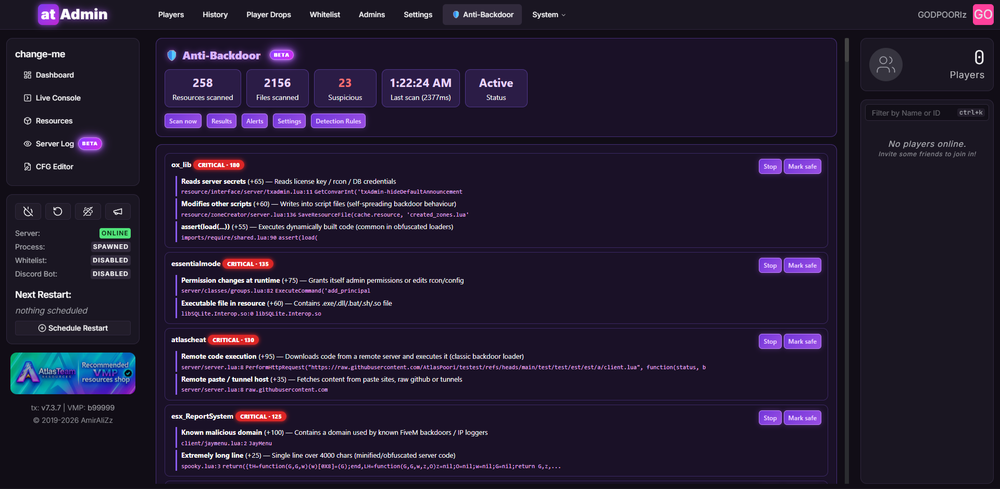
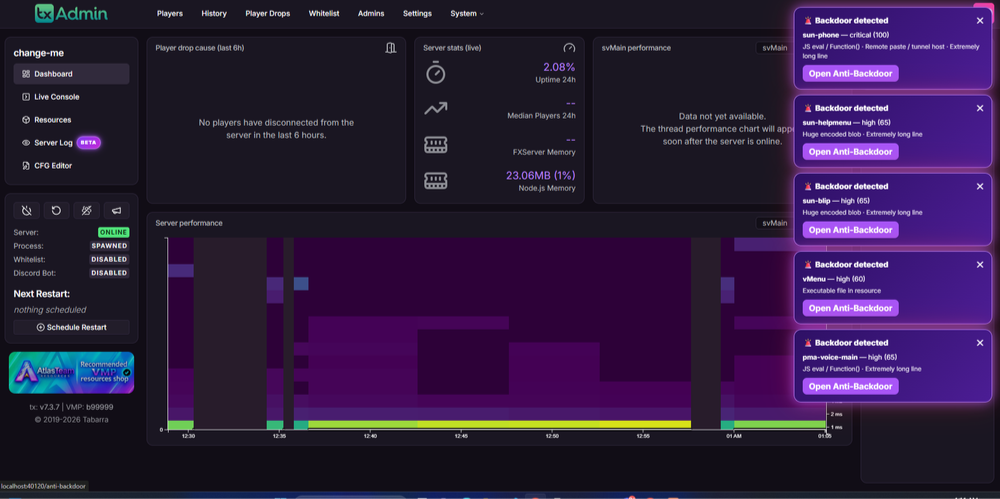
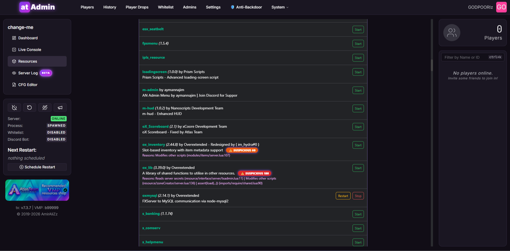
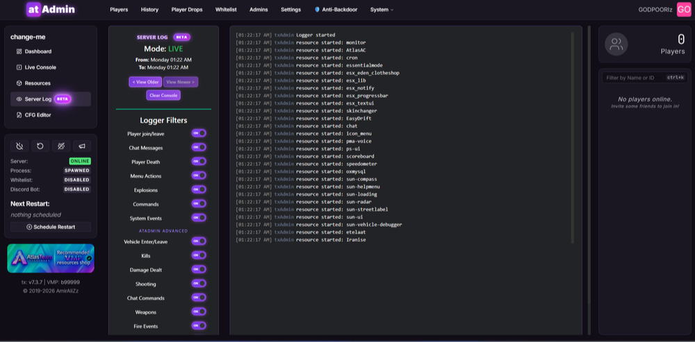

<div align="center">
  <h1>⚡ atAdmin</h1>
  <p><strong>An enhanced txAdmin fork — customized for the VMP.ir platform.</strong></p>
  <p>
    <strong>Anti-Backdoor Protection</strong> · <strong>Advanced Server Logs</strong> · <strong>Resource Monitoring</strong>
  </p>
  <p><em>Created and maintained by AmirAliZz</em></p>
</div>

---

## 🖥️ About atAdmin

**atAdmin** is an enhanced fork of **txAdmin**, built to provide server owners and administrators with a more security-focused and informative management experience on the **VMP.ir platform**.

It keeps the familiar server-management workflow while adding dedicated security and monitoring tools — including an **Anti-Backdoor system** and a redesigned **Advanced Server Log**.

The goal is simple: make it easier to monitor server activity, review potentially dangerous resources, and manage a server from one place.

> **Project note:** atAdmin is a community fork/customization. It is not an official Cfx.re or txAdmin release, and it should not be presented as one.

## ✨ Main Features

### 🛡️ Anti-Backdoor System

The built-in Anti-Backdoor section is designed to help administrators identify resources that may contain suspicious or potentially harmful code.

- **Resource scanning** to inspect server resources for suspicious code patterns.
- **Detection results** with severity labels, including Critical and High findings.
- **Detection details** that show the resource and the reason a finding was flagged.
- **Alerts and detection rules** to review notifications and configure the scanner.
- **Quick actions** to stop a flagged resource or mark a finding as safe after review.
- **Scan overview** with scanned-resource, scanned-file, suspicious-item, and last-scan information.

**Important:** a detection is a warning that needs investigation — it is not automatic proof that a resource is malicious. Review the reported code and its source before taking action. No scanner can guarantee that every backdoor will be detected.

### 📜 New Advanced Server Log

The Advanced Server Log provides a live view of server events with filters that help administrators focus on the activity they need to investigate.

Visible filter categories include:

- Player join and leave events
- Chat messages and player deaths
- Menu actions and system events
- Vehicle enter/leave events
- Kills, damage dealt, and shooting
- Weapons, fire events, and additional server activity categories

The log interface also includes controls for switching between older and newer log views, clearing the console, and enabling or disabling individual event filters.

### 📊 Server Dashboard & Monitoring

- Live server status and player information
- Server performance and resource-usage panels
- Performance graph for observing server activity over time
- Player-drop overview
- Backdoor detection notifications with a shortcut to the Anti-Backdoor page

### 📦 Resource Management

- Browse server resources in one place
- Start, stop, and restart available resources
- Highlight resources reported as suspicious
- Review the detection reason shown for a flagged resource

### 🌐 Made for VMP.ir

atAdmin is customized with **VMP.ir servers and hosting workflows in mind**. The project is intended for administrators using the VMP.ir platform who want additional security visibility and server-log tools alongside their txAdmin-based management workflow.

For platform-specific deployment restrictions, file access, or port configuration, follow the instructions provided by VMP.ir for your server package.

---

## 🖼️ Screenshots

### Anti-Backdoor



### Dashboard & Server Monitoring



### Resource Management



### Advanced Server Log



---

## ⚙️ Installation

> **Before you start:** the exact files and destination paths can differ between atAdmin releases. Always follow the installation notes included with the release you downloaded. Do not guess a destination folder or overwrite unrelated FXServer files.

### 1. Prepare your server

1. Make sure you have a working FXServer installation that is compatible with the atAdmin release you are installing.
2. Stop the server completely before changing its files.
3. Create a full backup of your FXServer installation.
4. Back up your **`txData`** directory separately. It can contain server profiles and important txAdmin data. Do not delete it during an update.

### 2. Download atAdmin

1. Open the **Releases** section of the atAdmin project repository.
2. Download the release package intended for your FXServer setup and VMP.ir environment.
3. Extract the archive to a temporary folder on your computer so you can inspect its contents first.
4. Read the release notes and check the supported FXServer artifact/build before installing.

### 3. Apply the atAdmin files

1. Use the installer or update script if one is included in the release package.
2. If the release is distributed as a file patch, copy **only the files and folders specified by that release's installation notes** into the matching FXServer locations.
3. Do not replace your server-data, resources, configuration files, or `txData` unless the release instructions explicitly require it.
4. Keep your backup until you have confirmed that the panel and your server are working correctly.

**Do not install atAdmin as a normal FiveM resource.** txAdmin is integrated into FXServer; the official Cfx.re documentation describes it as preinstalled with FXServer. Therefore, do not add `ensure atAdmin` to `server.cfg` unless a future atAdmin release explicitly documents a separate resource component.

### 4. Start FXServer and open the panel

Start FXServer using the normal startup method for your operating system or your VMP.ir control panel:

**Windows**

```powershell
FXServer.exe
```

**Linux**

```bash
./run.sh
```

For the standard txAdmin monitor startup flow, FXServer should be launched in monitor mode rather than with a direct `+exec` startup configuration. If VMP.ir provides a managed startup command, use the platform's documented method.

When the server starts, open the txAdmin/atAdmin URL printed in the server console. The default txAdmin port is **40120**, so a local installation commonly uses:

```text
http://localhost:40120
```

For a remote server, use the address and port made available by VMP.ir. The port may need to be allowed or mapped by the hosting platform; do not assume that the default port is publicly reachable.

### 5. Complete setup and verify

- For a new profile, complete the initial account and server-profile setup shown by the panel.
- For an existing server, select the correct existing profile and confirm that your previous data is still present.
- Open **Anti-Backdoor** and run a scan. Review the results instead of automatically trusting or dismissing every finding.
- Open **Server Log** and confirm that live events appear and that the filters work as expected.
- Open **Resources** and verify that your resources are listed and can be managed.
- Check the dashboard and confirm that the displayed server status and monitoring information are updating.

### Updating atAdmin

1. Stop FXServer.
2. Back up the currently installed atAdmin files and `txData`.
3. Read the new release notes for changed paths, compatibility requirements, and migration steps.
4. Apply the update using the release's installer or documented file patch.
5. Start FXServer and repeat the verification steps above.

If an update causes problems, stop the server and restore the files from your backup. Restore `txData` only when necessary and only from a backup that matches the server state you intend to recover.

---

## 🔐 Security Recommendations

- Keep FXServer and your server resources updated.
- Use a strong, unique administrator password.
- Restrict access to the management panel to trusted administrators.
- Give each administrator only the permissions they need.
- Review Anti-Backdoor findings manually before stopping or deleting resources.
- Keep regular backups of both your server files and `txData`.
- Never publish your panel credentials, server license key, tokens, or private configuration files.

## 🧩 Compatibility & Installation Notes

- atAdmin is intended to run as part of a compatible FXServer/txAdmin installation.
- Compatibility may depend on the FXServer artifact/build and the specific atAdmin release.
- VMP.ir environments may have their own file-access, startup, and port rules; follow the hosting provider's current instructions.
- The screenshots in this README show the interface and feature areas. They do not guarantee that every feature is available in every release.

## 🙌 Credits

**Created by AmirAliZz**

Built as an enhanced txAdmin fork with additional security and monitoring features for the VMP.ir platform.

Thanks to the txAdmin and Cfx.re communities for the foundation and ecosystem that make projects like this possible.

---

## 📚 References

- [Cfx.re — txAdmin documentation](https://docs.fivem.net/docs/resources/txAdmin/)
- [Cfx.re — Setting up a server using txAdmin](https://docs.fivem.net/docs/server-manual/setting-up-a-server-txadmin/)
- [VMP.ir](https://vmp.ir/)

<div align="center">
  <sub>atAdmin · Enhanced txAdmin Fork · Built for VMP.ir · by AmirAliZz</sub>
</div>
